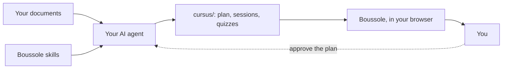

# Boussole

Turn your own course documents into a real course — lessons, quizzes, exercises checked as you
go, hints in tiers, videos and PDFs beside the text — and plan when to study it. Everything runs
on your machine.

> Status: the course format, the agent skills and the session player work. Planning and
> reminders come next. See the [roadmap](ARCHITECTURE.md#11-roadmap).

## How it works

1. Put your documents in a folder: lecture notes, slides and past exams, but also a software
   manual, a company guide or the documentation of a programming language.
2. `boussole init <folder>` installs instructions for AI agents next to them.
3. Ask your agent (Claude Code, Codex, Gemini CLI…) to build the course. It proposes a syllabus,
   you approve it, it writes the sessions in the [Boussole format](docs/FORMAT.md) and checks
   them with `boussole validate`.
4. `boussole open <folder>` and study in your browser: quizzes and exercises are checked as you
   answer, hints come one at a time, videos and your PDFs open beside the text.

No documents? `boussole new "Python" --goal "automate my work"` creates an empty track; your
agent asks what you want to learn, finds open sources, cites each one, and proposes a plan.



Boussole itself never calls an AI and needs no account. A short guide, itself a Boussole course
([`guide/`](guide)), walks through all of this: it is where a new Boussole opens, and it stays
apart on the home page to come back to.

## Documentation

- [Course format](docs/FORMAT.md) — the contract between authors, agents and the application.
- [Architecture](ARCHITECTURE.md) — modules, design patterns, conventions.
- [Example subject](examples/reseaux).
- [Working on Boussole](AGENTS.md) — for people and agents changing the code: what each kind of change touches.
- [Contributing](CONTRIBUTING.md) — commits, versions, changelog, releases.

## License

Apache License 2.0 with the Commons Clause: use it, change it, share it, contribute, in a
school, an association, a public body or a company, for free. What you may not do is sell
Boussole, or a service whose value comes mostly from it (a paid hosted version, for instance).
Keep the [`LICENSE`](LICENSE) and [`NOTICE`](NOTICE) files when you share it.

Boussole is therefore *source-available*, not *open source* in the OSI sense.

## Building

Requires Java 25 and Maven 3.9 (Node is downloaded by the build).

```
mvn verify
```

Then link the launcher into your `PATH`, and open the example subject:

```
ln -s "$PWD/bin/boussole" ~/.local/bin/boussole
boussole open examples/reseaux
```

`boussole open` starts the server in the background (it listens on this machine only, port
7420) and adds the folder to `~/.config/boussole/config.yaml`; `boussole stop` stops it. Your
progress is kept in `~/.local/share/boussole/state.db`.

To work on the interface, run `boussole serve`, then `npm start` in `web/`
(http://localhost:4200, calls to `/api` go to the server).
