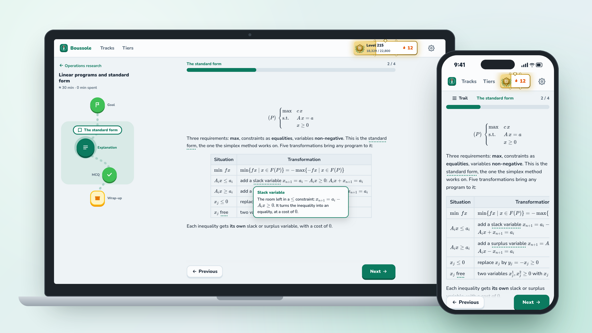
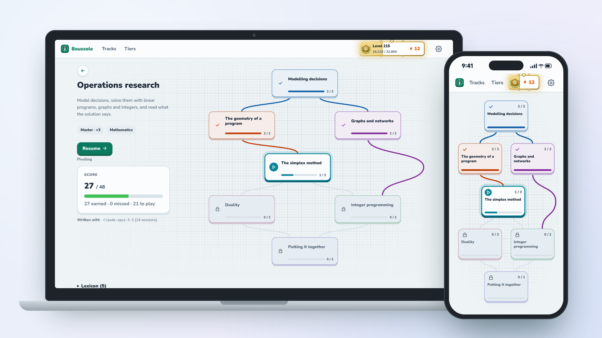
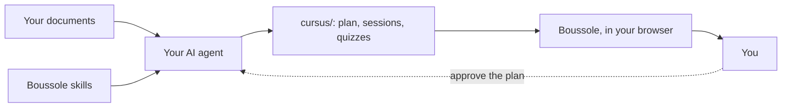

# Boussole

Turn your own course documents into a real course — lessons, quizzes, exercises checked as you
go, hints in tiers, videos and PDFs beside the text — and plan when to study it. Everything runs
on your machine.

> Status: the course format, the agent skills and the session player work. Planning and
> reminders come next. See the [roadmap](ARCHITECTURE.md#11-roadmap).



## The spirit of Boussole

Boussole is for those who love to learn: students, teachers, researchers, the curious, and anyone
who has ever closed a course knowing they had not really understood it.

Knowledge is widely accessible. But reaching a piece of information and learning something are
not the same thing. Between the two lies work: organising ideas, understanding what links them,
getting things wrong, starting again, and ending up able to reason without the course in front
of you.

That work is what Boussole sets out to support. From the documents of a course, or from the
knowledge someone wants to pass on, it builds a track to study step by step, at one's own pace.
Tracks can be written by hand or created with the help of AI agents. Boussole replaces neither
lectures, nor tutorials, nor teachers. It offers another way to learn and to pass knowledge on.

### Learning, and making knowledge accessible

Boussole draws on research on learning to offer another way of working with knowledge: not only
reading and rereading, but also trying to remember, testing one's understanding against
questions, understanding one's mistakes and meeting ideas again over time.

These choices rest in particular on work on retrieval practice, spaced practice and prior
knowledge. They are no guarantee of effectiveness. They are leads we can put into practice,
examine and improve.

But learning is only part of the subject. **Popularisation matters just as much.** Much
knowledge is available without being truly accessible to those who would like to discover it.
The vocabulary, the prerequisites and the codes of a discipline can be enough to discourage
someone before they have grasped its first ideas.

Making knowledge accessible does not mean erasing its complexity. It means building ways in,
giving the keys needed to start understanding, then letting everyone go further. Introductory
ideas in particular should not stay reserved for those who already have the right resources,
the right people around them or the means to follow specialised teaching.

That too is what Boussole hopes to make possible: giving knowledge more ways in, without
claiming to replace the depth of a course, the guidance of a teacher or the work it takes to
master a discipline.

Operations research was my first testing ground. I built a track from the course slides and
found this way of working more motivating than a revision plan prepared by hand. This personal
experience does not prove the method will suit everyone, but it made me want to carry the
project on.

### A format, methods and agents

The Boussole format makes it possible to create tracks without depending on artificial
intelligence. You can write your course yourself, organise the ideas, write the questions and
their corrections, then share the result. AI is one way to make this work easier, not a
condition for passing on knowledge.

Boussole also offers a way of producing tracks built on AI agents and on *skills* that guide
their work. Rather than asking a model to produce a whole course from a general instruction,
this system relies on specialised instructions and method sheets to frame how tracks are
created.

These methods are not hidden in an unreachable service: they are part of the project. They can
be read, changed and reused. The *skills* can evolve, the agents can be evaluated, the methods
can be discussed. An improvement to this system can then serve the courses produced afterwards,
not just one particular track.

Much remains to explore, both in the teaching quality of the contents and in their cost of
production. To give an order of magnitude, writing a 59-session track took the equivalent of
about 14 million input tokens with Claude Opus 5.5 ([measurements](docs/research/couts.md)). Can
comparable quality be reached with smaller or open models, at a lower cost? Which tasks should
be given to agents, and which would be better handled otherwise? These are open questions.

### In the spirit of sharing

Boussole is free, and it should stay free. What you learn with it is yours: your skills, your
work, what you will make of them, your job included. But the tool, its format and the courses
written for it are meant to circulate freely, not to be sold. No one should have to pay to reach
what others gave for learning.

This freedom also covers the means of producing and passing on knowledge. The code, the format,
the courses, the method sheets and the *skills* are meant to be examined, taken up and improved.
Everyone can build on the work of others without starting from scratch, and bring in turn what
they have learnt.

This does not mean that the work of teaching, research or development has no value. It is about
making sure that shared knowledge and tools can keep circulating, independently of those who
first created them.

### How to take part

There is no single way to take part in the project.

You can use a track and point out what is missing, what is confusing or what could be explained
better. You can create your own course, translate an existing track or suggest another way of
presenting an idea.

You can also work on the method sheets and the *skills*, contribute to the code, try other AI
models, or look for ways to improve the quality of tracks at a lower cost. All these
contributions answer different needs, but can benefit the same project.

Boussole is still being built. You can simply use it, follow how it evolves, or help improve it
when you have something to bring. The methods, the technical choices and the courses are not set
in stone: they are there to be used, discussed and, when needed, questioned.



## How it works

1. Put your documents in a folder: lecture notes, slides and past exams, but also a software
   manual, a company guide or the documentation of a programming language.
2. `boussole init <folder>` installs instructions for AI agents next to them.
3. Ask your agent (Claude Code, Codex, Gemini CLI…) to build the course. It proposes a syllabus,
   you approve it, it writes the sessions in the [Boussole format](docs/FORMAT.md) and checks
   them with `boussole validate`.
4. `boussole open <folder>` and study in your browser: quizzes and exercises are checked as you
   answer, hints come one at a time, videos and your PDFs open beside the text.

No documents? `boussole new "Python" --goal "automate my work"` creates an empty track; your
agent asks what you want to learn, finds open sources, cites each one, and proposes a plan.

On another device of the same network (a phone, a tablet, a TV): add `network: true` to
`config.yaml`, restart Boussole, then `boussole devices pair` shows a QR code and a code to type.
Without a keyboard, the device shows a code; accept it with `boussole devices accept <code>`.
`boussole devices` lists them; `boussole devices remove <name>` takes one away.

`boussole` alone gathers it full screen in the terminal (beta): the server (start, stop,
network), the devices, and your tracks with their problems and their new documents.



Boussole itself never calls an AI and needs no account. A short guide, itself a Boussole course
([`guide/getting-started`](guide/getting-started)), walks through all of this: it is where a new Boussole opens, and it stays
apart on the home page to come back to.

## Installing

Download the archive for your system from the [releases](https://github.com/lucasssoh/Boussole/releases):
Boussole comes with its own Java, nothing else to install.

| System | Archive | The `boussole` command |
|---|---|---|
| Linux | `boussole-<version>-linux-x64.tar.gz` | `boussole/bin/boussole` |
| macOS | `boussole-<version>-macos-arm64.tar.gz` | `boussole.app/Contents/MacOS/boussole` |
| Windows | `boussole-<version>-windows-x64.zip` | `boussole\boussole.exe` |

On Linux, for instance:

```
tar -xzf boussole-*-linux-x64.tar.gz -C ~/.local/share
ln -s ~/.local/share/boussole/bin/boussole ~/.local/bin/boussole
boussole open
```

On macOS, the archive is not signed yet: after extracting it, run
`xattr -dr com.apple.quarantine boussole.app` once.

## Documentation

- [Course format](docs/FORMAT.md) — the contract between authors, agents and the application.
- [Architecture](ARCHITECTURE.md) — modules, design patterns, conventions.
- [Example subject](examples/reseaux).
- [Working on Boussole](AGENTS.md) — for people and agents changing the code: what each kind of change touches.
- [Contributing](CONTRIBUTING.md) — commits, versions, changelog, releases.

## License

Boussole has two licences, one for its software and one for its contents.

- **The software**: Apache License 2.0 with the Commons Clause ([`LICENSE`](LICENSE)). Use it,
  change it, share it, contribute, in a school, an association, a public body or a company, for
  free. What you may not do is sell Boussole, or a service whose value comes mostly from it (a
  paid hosted version, for instance). Boussole is therefore *source-available*, not *open
  source* in the OSI sense.
- **The contents**: the built-in tracks ([`guide/`](guide)), the playbooks ([`skills/`](skills)),
  the [course format](docs/FORMAT.md) and the [research notes](docs/research) are under
  [CC BY-NC-SA 4.0](LICENSE-CONTENT): copy, adapt and share them, crediting Boussole, not for
  commercial purposes, and under the same licence.

Keep the [`LICENSE`](LICENSE), [`LICENSE-CONTENT`](LICENSE-CONTENT) and [`NOTICE`](NOTICE) files
when you share Boussole. The tracks you write are yours, under the licence you choose; when they
are built from the documents of others, those documents keep their authors' rights.

## Building

From the sources, Boussole requires Java 25 and Maven 3.9 (Node is downloaded by the build).

```
mvn verify
```

Then link the launcher into your `PATH`, and open the example subject:

```
ln -s "$PWD/bin/boussole" ~/.local/bin/boussole
boussole open examples/reseaux
```

`boussole open` starts the server in the background (it listens on this machine only, port
7420) and adds the folder to `~/.config/boussole/config.yaml`; `boussole stop` stops it. Your
progress is kept in `~/.local/share/boussole/state.db`.

`boussole open <folder> --resume` opens the session to resume of that track, the one in
progress or else the next one: the command for a reminder in your calendar that says it is
time to study.

To work on the interface, run `boussole serve`, then `npm start` in `web/`
(http://localhost:4200, calls to `/api` go to the server).
