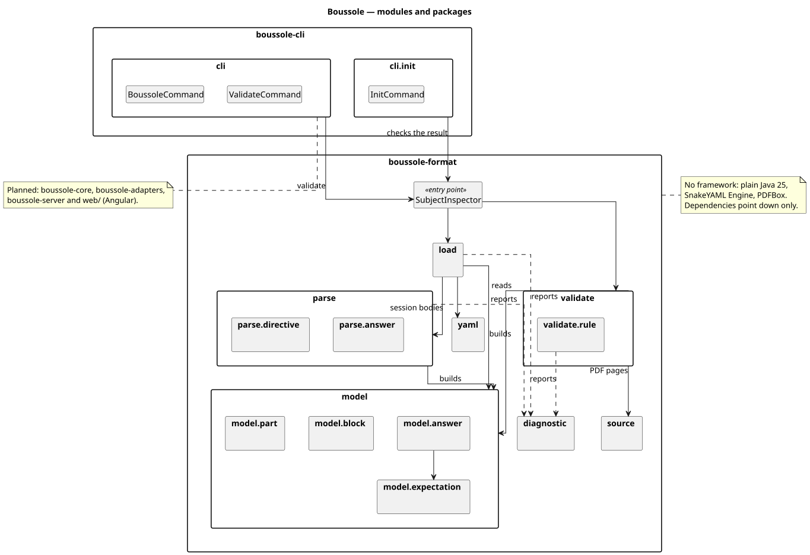

# Class diagrams

PlantUML sources (`*.puml`, each self-contained) and their rendering (`*.svg`). One diagram per area, so each stays
readable; the overview says where each area sits.

| Diagram | Shows |
|---|---|
| [Overview](00-overview.svg) | modules and packages, and how they depend on each other |
| [Course model](10-model-course.svg) | `Course`, the syllabus, the lexicon, the learner's profile, sessions and their parts |
| [Blocks](11-model-blocks.svg) | what a session is made of: prose, examples, videos, exercises, MCQs… |
| [Answers](12-model-answers.svg) | what exercises accept: answers made of expectations (text, number, choice) |
| [Parsing: structure](20-parsing-structure.svg) | from a session file to parts and blocks: raw tree, directives |
| [Parsing: answers](21-parsing-answers.svg) | how each exercise type reads its answer |
| [Loading](30-loading.svg) | reading a subject folder: YAML files, sessions, diagnostics |
| [Validation](31-validation.svg) | the rules that check a whole course |
| [CLI](40-cli.svg) | `boussole open`, `serve`, `stop`, `validate` and `init` |
| [Core: studying](50-core-learn.svg) | the use cases, the ports, and how responses are checked |
| [Adapters](60-adapters.svg) | subject folders, SQLite, `config.yaml`, YouTube |
| [Server](70-server.svg) | the HTTP API and the views it sends, answers left out |
| [Interface](80-web.svg) | the Angular pages, blocks and questions |

To see them: open an `.svg` in a browser, or this page on GitHub. To edit them, any PlantUML
editor works (the PlantUML extension of VS Code or IntelliJ shows a live preview).

After changing a `.puml` file, render again (needs `plantuml` and `graphviz`):

```
docs/diagrams/render.sh
```


