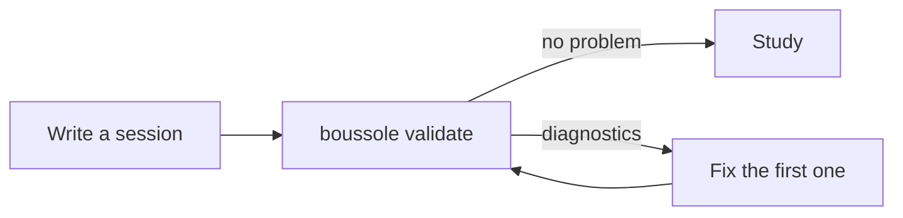

:::::warmup
::ref{id=f9-a3}
:::::

## Reading a diagnostic {#diagnostic}

**The validator prints lines of messages. Where do you start?** By reading the first one, from
left to right. Each line is a :term[diagnostic]{id=diagnostic}:

```
cursus/01-first-steps/s1-create-a-repository.md:24: warning P004 `s1-a1` has no hint: a learner who is stuck can only guess, then read the answer
```

| Piece | Here | Meaning |
|---|---|---|
| the file | `cursus/01-first-steps/s1-create-a-repository.md` | the file to open |
| the line | `24` | where to look in this file |
| the severity | `warning` | `error` keeps the track from opening, `warning` does not |
| the code | `P004` | to look up in `.boussole/FORMAT.md`, section 6 |
| the message | `` `s1-a1` has no hint… `` | what is wrong, and often what to write instead |

`F` codes are about the **format**: the file is badly written. `P` codes are about the **teaching
contract**: the file reads fine, but a question lacks a nudge, a notion lacks a question…

The last line sums up: `.: 2 errors, 1 warning; 1 of 2 sessions written.` With `--errors-only`,
the :term[validator]{id=validator} shows errors only.

:::example[A first pass on s1]
```
cursus/01-first-steps/s1-create-a-repository.md:1: error F030 `terms` lists `repository`, which is not in the lexicon
cursus/01-first-steps/s1-create-a-repository.md:10: error F013 `## What a repository is` needs an ID: `## What a repository is {#an-id}`
cursus/syllabus.yaml:14: warning F011 session `s2` is not written yet: cursus/01-first-steps/s2-first-commit.md
.: 2 errors, 1 warning; 1 of 2 sessions written.
```

1. `F030`, line 1, the front matter: `repository` is missing from the lexicon. Add it to
   `cursus/lexique.yaml`.
2. `F013`, line 10: the notion heading has no identifier. Write
   `## What a repository is {#repository}`.
3. `F011`: `s2` is not written yet. Normal while you write it: it is only a warning.
:::

::::exercise{#f10-a1 type=match}
Match each piece of `cursus/syllabus.yaml:14: warning F011 …` with its meaning.

:::answer
`cursus/syllabus.yaml` => the file to open
`14` => the line where to look
`warning` => the severity, which does not keep you from studying
`F011` => the code, to look up in the format
:::

:::hint
A diagnostic reads from left to right: where, then how serious, then what.
:::

:::solution
The file, the line, the severity (`warning`), then the code. The message comes after.
:::
::::

::::mcq{#f10-a2}
The summary says `0 errors, 3 warnings`. Can the track be opened in Boussole?

- [x] Yes: only errors keep it from opening
- [ ] No: the warnings must be fixed first
  > A warning reports a flaw to fix, without blocking the track.
- [ ] Only with `--errors-only`
  > This option hides warnings from the output; it changes nothing in the track.

:::hint
Read the "the severity" row of the table again.
:::

:::solution
**Yes.** Errors block, warnings do not. Fix them all the same: a track without warnings follows
the whole teaching contract.
:::
::::

## Common errors {#errors}

**Which errors come up most when writing by hand?** Almost always the same ones:

| Code | What happened | The fix |
|---|---|---|
| `F026` | a block never closed | close it with a line of as many colons as its opening |
| `F020` | an unknown directive (`:::exemple`) or the wrong form (`:::video`) | the English name, and the right number of colons |
| `F013` | a `##` heading without an identifier | add `{#an-id}` at the end of the heading |
| `F010` | the front matter `id` is not the plan's | repeat the plan's `id` |
| `F021` | a question without `:::solution`, or an `:::answer` written wrong for its type | one solution, an answer in the format of the type |
| `F022` | an MCQ with no ticked choice, or two without `multiple=true` | tick the right choice, or add `multiple=true` |
| `F030` | a `::ref`, a `:term` or a prerequisite that points to nothing | check the :term[identifier]{id=identifier} |
| `P004`, `P010` | a question without a nudge, a wrong choice without feedback | add `:::hint`, and `  > why` under the choice |

Then start again, until `no problem`:



:::tip
Fix from top to bottom, and run again after each fix: a block closed wrong can cause others
further down, which go away with it.
:::

:::example[Fixing an F026]
The validator says:

```
cursus/01-first-steps/s1-create-a-repository.md:27: error F026 `solution` is never closed
```

Line 27, the solution of `s1-a1`:

```markdown
:::solution
**The whole history**: every version lives in `.git`.
::::
```

`::::` closes the MCQ, not the solution. Add the missing line:

```markdown
:::solution
**The whole history**: every version lives in `.git`.
:::
::::
```

Run `boussole validate .` again: the `F026` is gone.
:::

::::exercise{#f10-a3 type=match}
Match each code with its fix.

:::answer
`F013` => add an identifier to the level-2 heading
`F026` => close the block with as many colons
`F010` => repeat the plan's identifier in the front matter
`P010` => write feedback under the wrong choice
:::

:::hint
`F013` is about a heading, `F026` a block, `F010` a front matter, `P010` an MCQ.
:::

:::solution
`F013`: `{#id}` on the heading; `F026`: the closing line; `F010`: the plan's `id`; `P010`: a
feedback `  > …` under the wrong choice.
:::
::::

::::exercise{#f10-a4 type=order}
Put the writing loop in order.

:::answer
1. Write or change a session
2. Run `boussole validate`
3. Fix the first diagnostic of the list
4. Run `boussole validate` again, until `no problem`
:::

:::hint
You only fix what the validator has reported.
:::

:::solution
Write, validate, fix the first diagnostic, validate again: until `no problem`.
:::
::::

:::::checkpoint
::::mcq{#f10-c1}
The validator says `s2-first-commit.md:1: error F010 the file says id: s1, the syllabus s2`.
What do you fix?

- [x] The `id` in the front matter of `s2-first-commit.md`, which must be `s2`
- [ ] The file name, to `s1-first-commit.md`
  > The file name has nothing to do with it: Boussole compares the front matter `id` with the
  > plan's.
- [ ] The lexicon
  > `F010` is about the `id` of a session, not of a term.

:::hint
Line 1 of a session is its front matter.
:::

:::solution
**The `id` in the front matter**: the plan expects `s2` for this file. A session copied from `s1`
often keeps its old `id`.
:::
::::
:::::

:::::practice
::::exercise{#f10-p1 type=free}
Your turn to write: session `s2` of Git basics, "The first commit", in
`cursus/01-first-steps/s2-first-commit.md`. It needs a front matter, a warmup on `s1`, a notion
with its example and a question, then a checkpoint. Run `boussole validate` until `no problem`.

:::hint
Start from the skeleton of `s1` (session f3), and reuse the front matter of `s2` (session f3 too).
:::

:::hint
The warmup can ask a question of `s1` again with `::ref`. For the notion, the `order` exercise of
session f7 fits.
:::

:::hint
Do not forget `commit` and `index` in the lexicon, nor a nudge and feedback for each question.
:::

:::solution
One possible version:

```markdown
---
id: s2
objectives:
  - Stage a file with git add.
  - Record a commit with git commit.
prerequisites: [git-basics.first-steps.s1]
terms: [commit, index]
---

:::::warmup
::ref{id=s1-a2}
:::::

**Your repository is ready: how do you record a first version in it?** With two commands.

## Stage, then record {#add-commit}

`git add` puts a file in the :term[index]{id=index}; `git commit` records everything the index
holds in a :term[commit]{id=commit}.

:::example[The home page of your website]
`git add index.html`, then `git commit -m "Add the home page"`. Git answers with the start of the
identifier of the commit and its message.
:::

::::exercise{#s2-a2 type=order}
Put the commands of the first commit in order.

:::answer
1. `git init`
2. `git add index.html`
3. `git commit -m "Add the home page"`
:::

:::hint
You can only add a file to a repository that exists.
:::

:::solution
The repository, then the index, then the commit.
:::
::::

:::::checkpoint
::::mcq{#s2-c1}
You run `git commit` without `git add` first, in a new repository. What happens?

- [x] Nothing is recorded: the index is empty
- [ ] All the files of the folder are recorded
  > `git commit` only records what the index holds.

:::hint
What does the index hold before the first `git add`?
:::

:::solution
**Nothing is recorded**: Git answers that there is nothing to commit.
:::
::::
:::::
```

Does the validator say `no problem`? Your session is ready to study.
:::
::::
:::::
