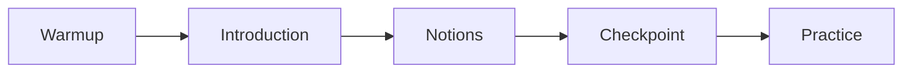

:::::warmup
::ref{id=f2-a1}
:::::

## The front matter {#front-matter}

**How does Boussole link a file to its place in the plan?** Through its
:term[front matter]{id=front-matter}: a YAML block between two `---` lines, at the very top of the
file.

| Field | Required | Meaning |
|---|---|---|
| `id` | yes | the same `id` as the session in the plan |
| `objectives` | yes | one to five sentences, each starting with a verb |
| `terms` | no | the identifiers of the :term[lexicon]{id=lexicon} used in the session |
| `prerequisites` | no | the **full** identifiers of the sessions to finish before: only those really needed. In guided mode, the session waits for them. |
| `sources` | no | the documents of `sources/`, with `#page=N` if needed |
| `written_by` | no | who wrote the session: an AI `model` (its exact ID) and its `tool`, or a `name`; the `date`; the `role` (`wrote`, `revised`, `translated`). The learner sees it. |

:::warning
A sentence holding ": " (colon and space) reads in YAML as a key and its value: put it in quotes,
`- "Read a diagnostic: from the file to the message."`.
:::

:::example[The front matter of session s2]
```markdown
---
id: s2
objectives:
  - Stage a file with git add.
  - Record a commit with git commit.
prerequisites: [git-basics.first-steps.s1]
terms: [commit, index]
sources:
  - progit.pdf#page=32
---
```

- `id: s2` repeats the `id` of the plan.
- `prerequisites` gives the full identifier of `s1`: track, chapter, session.
- `terms` cites terms of the lexicon (session f8); a term missing from the lexicon is an error.
- `sources` points to page 32 of the book kept in `sources/`.
:::

::::mcq{#f3-a1}
The file `s2-first-commit.md` starts with `id: s1`. What does the validator say?

- [x] An error: the `id` does not match the plan's
- [ ] Nothing: the file name is enough to link it to the plan
  > Boussole finds the file through `file`, then checks that its `id` is the session's.
- [ ] Only a warning
  > An `id` that does not match is an error (`F010`): the progress would be stored in the wrong
  > place.

:::hint
Progress is attached to identifiers: what would happen if two files said `s1`?
:::

:::solution
**An error** (`F010`): the `id` of the front matter must be the one the plan gives this session,
here `s2`.
:::
::::

::::exercise{#f3-a2 type=fill}
Fill in.

`objectives` lists from [[1]] to [[2]] sentences that start with [[3]]. `prerequisites` expects
[[4]] identifiers.

:::answer
1: number 1
2: number 5
3: choice *a verb | a noun | a title
4: choice *full | file | notion
:::

:::hint
Read the table of front matter fields again.
:::

:::hint
A prerequisite may come from another chapter: it needs the track, the chapter and the session.
:::

:::solution
From **1** to **5** sentences that start with **a verb**; **full** identifiers, such as
`git-basics.first-steps.s1`.
:::
::::

## The body, in order {#body}

**What goes under the front matter?** Markdown, read from top to bottom in this order:



| Part | How to write it | Required |
|---|---|---|
| Warmup | a `:::::warmup` block, first: a few questions on the previous session and on older ones | no, and never in the first session |
| Introduction | text before the first notion | no |
| Notions | each one starts with `## Title {#id}` and runs until the next `##` heading | at least one, in practice |
| Checkpoint | a `:::::checkpoint` block: a short quiz on the whole session | no, but advised |
| Practice | a `:::::practice` block, last: longer exercises | no |

Three heading rules:

- no `#` heading: the title of the session comes from the plan (`F012`);
- each `##` carries an identifier `{#id}`, unique in the session (`F013`);
- `###` headings and smaller are free, inside a notion.

In a :term[notion]{id=notion}: the explanation, **one** :term[worked example]{id=worked-example},
then at least one question. The validator reports a notion without a question (`P001`) or with
two examples (`P002`).

:::example[The skeleton of session s1]
```markdown
---
id: s1
objectives:
  - Say what a Git repository is.
  - Create a repository with git init.
terms: [repository]
---

**Where does Git keep the history of your project?** In a repository.

## What a repository is {#repository}

The explanation, an example, then a question.

## Creating a repository {#init}

The explanation, an example, then a question.

:::::checkpoint
Two or three questions on the whole session.
:::::
```

First session of the track: no warmup. Session `s2` will have one, on `s1`.
:::

::::exercise{#f3-a3 type=order}
Put the parts of a session in the order of the file.

:::answer
1. The front matter, between two `---` lines
2. The warmup, `:::::warmup`
3. The introduction
4. The notions, each one `## Title {#id}`
5. The checkpoint, `:::::checkpoint`
6. The practice, `:::::practice`
:::

:::hint
The front matter is always at the very top, the practice always at the very bottom.
:::

:::hint
The warmup goes back over earlier sessions: it opens the session, even before the
introduction.
:::

:::solution
Front matter, warmup, introduction, notions, checkpoint, practice. Only the front matter and the
notions are essential.
:::
::::

::::mcq{#f3-a4}
Which notion heading is valid?

- [x] `## Creating a repository {#init}`
- [ ] `# Creating a repository {#init}`
  > A `#` heading is not allowed in a session: its title comes from the plan.
- [ ] `## Creating a repository`
  > The identifier of the notion is missing: `{#init}`.
- [ ] `## Creating a repository {#Init}`
  > An identifier is written in lowercase.

:::hint
A notion heading has two hash signs and a lowercase identifier.
:::

:::solution
**`## Creating a repository {#init}`**: level 2, and an identifier in lowercase letters, digits
and hyphens.
:::
::::

:::::checkpoint
::::mcq{#f3-c1 multiple=true}
A notion holds an explanation and two `:::example`, but no question. What does the validator
report? (several answers)

- [x] A notion without a question (`P001`)
- [x] A notion with more than one example (`P002`)
- [ ] A level-1 heading (`F012`)
  > Nothing says the notion has a `#` heading: it starts with `##`.
- [ ] Missing front matter (`F001`)
  > The front matter is about the whole session, not one notion.

:::hint
Count what the notion has too much of, and what it lacks.
:::

:::solution
**`P001` and `P002`**: a question is missing, and there is one example too many. The second
example becomes precisely the missing question.
:::
::::
:::::
