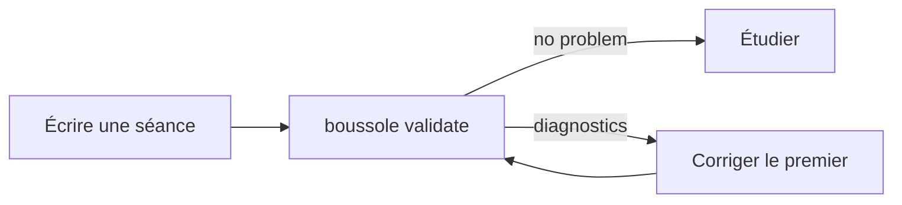

:::::warmup
::ref{id=f9-a3}
:::::

## Lire un diagnostic {#diagnostic}

**Le validateur affiche des lignes de messages. Par où commencer ?** Par lire la première, de
gauche à droite. Chaque ligne est un :term[diagnostic]{id=diagnostic} :

```
cursus/01-premiers-pas/s1-creer-un-depot.md:24: warning P004 `s1-a1` has no hint: a learner who is stuck can only guess, then read the answer
```

| Morceau | Ici | Sens |
|---|---|---|
| le fichier | `cursus/01-premiers-pas/s1-creer-un-depot.md` | le fichier à ouvrir |
| la ligne | `24` | où regarder dans ce fichier |
| la gravité | `warning` | `error` empêche d'ouvrir le parcours, `warning` non |
| le code | `P004` | à chercher dans `.boussole/FORMAT.md`, section 6 |
| le message | `` `s1-a1` has no hint… `` | en anglais : ce qui ne va pas, et souvent quoi écrire à la place |

Les codes en `F` portent sur le **format** : le fichier est mal écrit. Les codes en `P` portent sur
le **contrat pédagogique** : le fichier se lit, mais une question manque de coup de pouce, une
notion de question…

La dernière ligne fait le bilan : `.: 2 errors, 1 warning; 1 of 2 sessions written.` Avec
`--errors-only`, le :term[validateur]{id=validator} n'affiche que les erreurs.

:::example[Un premier passage sur s1]
```
cursus/01-premiers-pas/s1-creer-un-depot.md:1: error F030 `terms` lists `depot`, which is not in the lexicon
cursus/01-premiers-pas/s1-creer-un-depot.md:10: error F013 `## Ce qu'est un dépôt` needs an ID: `## Ce qu'est un dépôt {#an-id}`
cursus/syllabus.yaml:14: warning F011 session `s2` is not written yet: cursus/01-premiers-pas/s2-premier-commit.md
.: 2 errors, 1 warning; 1 of 2 sessions written.
```

1. `F030`, ligne 1, l'en-tête : `depot` manque au lexique. On l'ajoute à `cursus/lexique.yaml`.
2. `F013`, ligne 10 : le titre de notion n'a pas d'identifiant. On écrit
   `## Ce qu'est un dépôt {#depot}`.
3. `F011` : `s2` n'est pas encore écrite. Normal tant qu'on l'écrit : ce n'est qu'un
   avertissement.
:::

::::exercise{#f10-a1 type=match}
Associe chaque morceau de `cursus/syllabus.yaml:14: warning F011 …` à son sens.

:::answer
`cursus/syllabus.yaml` => le fichier à ouvrir
`14` => la ligne où regarder
`warning` => la gravité, qui n'empêche pas d'étudier
`F011` => le code, à chercher dans le format
:::

:::hint
Un diagnostic se lit de gauche à droite : où, puis à quel point c'est grave, puis quoi.
:::

:::solution
Le fichier, la ligne, la gravité (`warning` : un avertissement), puis le code. Le message vient
après.
:::
::::

::::mcq{#f10-a2}
Le bilan dit `0 errors, 3 warnings`. Peut-on ouvrir le parcours dans Boussole ?

- [x] Oui : seules les erreurs empêchent de l'ouvrir
- [ ] Non : il faut d'abord corriger les avertissements
  > Un avertissement signale un défaut à corriger, sans bloquer le parcours.
- [ ] Seulement avec `--errors-only`
  > Cette option masque les avertissements à l'affichage ; elle ne change rien au parcours.

:::hint
Relis la ligne « la gravité » du tableau.
:::

:::solution
**Oui.** Les erreurs bloquent, les avertissements non. Corrige-les quand même : un parcours sans
avertissement respecte tout le contrat pédagogique.
:::
::::

## Les erreurs fréquentes {#errors}

**Quelles erreurs reviennent le plus quand on écrit à la main ?** Presque toujours les mêmes :

| Code | Ce qui s'est passé | La correction |
|---|---|---|
| `F026` | un bloc jamais fermé | ferme-le par une ligne d'autant de deux-points que son ouverture |
| `F020` | une directive inconnue (`:::exemple`) ou de la mauvaise forme (`:::video`) | le nom anglais, et le bon nombre de deux-points |
| `F013` | un titre `##` sans identifiant | ajoute `{#un-id}` à la fin du titre |
| `F010` | l'`id` de l'en-tête n'est pas celui du plan | reprends l'`id` du plan |
| `F021` | une question sans `:::solution`, ou un `:::answer` mal écrit pour son type | une solution, une réponse au format du type |
| `F022` | un QCM sans choix coché, ou deux sans `multiple=true` | coche le bon choix, ou ajoute `multiple=true` |
| `F030` | un `::ref`, un `:term` ou un prérequis qui ne pointe sur rien | vérifie l':term[identifiant]{id=identifier} |
| `P004`, `P010` | une question sans coup de pouce, un mauvais choix sans retour | ajoute `:::hint`, et `  > pourquoi` sous le choix |

Puis on recommence, jusqu'à `no problem` :



:::tip
Corrige de haut en bas, et relance après chaque correction : un bloc mal fermé peut en entraîner
d'autres plus bas, qui disparaissent avec lui.
:::

:::example[Corriger un F026]
Le validateur dit :

```
cursus/01-premiers-pas/s1-creer-un-depot.md:27: error F026 `solution` is never closed
```

Ligne 27, la solution de `s1-a1` :

```markdown
:::solution
**Tout l'historique** : chaque version vit dans `.git`.
::::
```

`::::` ferme le QCM, pas la solution. On ajoute la ligne qui manque :

```markdown
:::solution
**Tout l'historique** : chaque version vit dans `.git`.
:::
::::
```

On relance `boussole validate .` : le `F026` a disparu.
:::

::::exercise{#f10-a3 type=match}
Associe chaque code à sa correction.

:::answer
`F013` => ajouter un identifiant au titre de niveau 2
`F026` => fermer le bloc par autant de deux-points
`F010` => reprendre l'identifiant du plan dans l'en-tête
`P010` => écrire un retour sous le mauvais choix
:::

:::hint
`F013` parle d'un titre, `F026` d'un bloc, `F010` d'un en-tête, `P010` d'un QCM.
:::

:::solution
`F013` : `{#id}` au titre ; `F026` : la ligne de fermeture ; `F010` : l'`id` du plan ; `P010` : un
retour `  > …` sous le mauvais choix.
:::
::::

::::exercise{#f10-a4 type=order}
Remets dans l'ordre la boucle d'écriture.

:::answer
1. Écrire ou modifier une séance
2. Lancer `boussole validate`
3. Corriger le premier diagnostic de la liste
4. Relancer `boussole validate`, jusqu'à `no problem`
:::

:::hint
On ne corrige que ce que le validateur a signalé.
:::

:::solution
Écrire, valider, corriger le premier diagnostic, revalider : jusqu'à `no problem`.
:::
::::

:::::checkpoint
::::mcq{#f10-c1}
Le validateur dit `s2-premier-commit.md:1: error F010 the file says id: s1, the syllabus s2`.
Que corriges-tu ?

- [x] L'`id` de l'en-tête de `s2-premier-commit.md`, qui doit valoir `s2`
- [ ] Le nom du fichier, en `s1-premier-commit.md`
  > Le nom du fichier n'a rien à voir : Boussole compare l'`id` de l'en-tête à celui du plan.
- [ ] Le lexique
  > `F010` parle de l'`id` d'une séance, pas d'un terme.

:::hint
La ligne 1 d'une séance, c'est son en-tête.
:::

:::solution
**L'`id` de l'en-tête** : le plan attend `s2` pour ce fichier. Une séance copiée depuis `s1` garde
souvent son ancien `id`.
:::
::::
:::::

:::::practice
::::exercise{#f10-p1 type=free}
À toi d'écrire : la séance `s2` des bases de Git, « Le premier commit », dans
`cursus/01-premiers-pas/s2-premier-commit.md`. Il lui faut un en-tête, un échauffement sur `s1`,
une notion avec son exemple et une question, puis un point de contrôle. Lance `boussole validate`
jusqu'à `no problem`.

:::hint
Pars du squelette de `s1` (séance f3), et reprends l'en-tête de `s2` (séance f3 aussi).
:::

:::hint
L'échauffement peut reprendre une question de `s1` avec `::ref`. Pour la notion, l'exercice
`order` de la séance f7 convient.
:::

:::hint
N'oublie pas `commit` et `index` dans le lexique, ni un coup de pouce et des retours pour chaque
question.
:::

:::solution
Une version possible :

```markdown
---
id: s2
objectives:
  - Préparer un fichier avec git add.
  - Enregistrer un commit avec git commit.
prerequisites: [git-bases.premiers-pas.s1]
terms: [commit, index]
---

:::::warmup
::ref{id=s1-a2}
:::::

**Ton dépôt est prêt : comment y enregistrer une première version ?** En deux commandes.

## Préparer, puis enregistrer {#add-commit}

`git add` place un fichier dans l':term[index]{id=index} ; `git commit` enregistre tout ce que
l'index contient dans un :term[commit]{id=commit}.

:::example[La page d'accueil de ton site]
`git add index.html`, puis `git commit -m "Ajoute la page d'accueil"`. Git répond avec le
début de l'identifiant du commit et son message.
:::

::::exercise{#s2-a2 type=order}
Remets dans l'ordre les commandes du premier commit.

:::answer
1. `git init`
2. `git add index.html`
3. `git commit -m "Ajoute la page d'accueil"`
:::

:::hint
On n'ajoute un fichier qu'à un dépôt qui existe.
:::

:::solution
Le dépôt, puis l'index, puis le commit.
:::
::::

:::::checkpoint
::::mcq{#s2-c1}
Tu lances `git commit` sans `git add` avant, sur un dépôt neuf. Que se passe-t-il ?

- [x] Rien n'est enregistré : l'index est vide
- [ ] Tous les fichiers du dossier sont enregistrés
  > `git commit` n'enregistre que ce que l'index contient.

:::hint
Que contient l'index avant le premier `git add` ?
:::

:::solution
**Rien n'est enregistré** : Git répond qu'il n'y a rien à valider.
:::
::::
:::::
```

Le validateur dit `no problem` ? Ta séance est prête à étudier.
:::
::::
:::::
