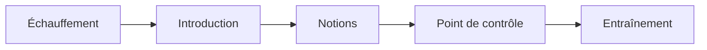

:::::warmup
::ref{id=f2-a1}
:::::

## L'en-tête {#front-matter}

**Comment Boussole relie-t-il un fichier à sa place dans le plan ?** Par son
:term[en-tête]{id=front-matter} : un bloc YAML entre deux lignes `---`, tout en haut du fichier.

| Champ | Obligatoire | Sens |
|---|---|---|
| `id` | oui | le même `id` que la séance dans le plan |
| `objectives` | oui | de une à cinq phrases, chacune commence par un verbe |
| `terms` | non | les identifiants du :term[lexique]{id=lexicon} employés dans la séance |
| `prerequisites` | non | les identifiants **complets** des séances à terminer avant : seulement celles vraiment nécessaires. En mode guidé, la séance les attend. |
| `sources` | non | les documents de `sources/`, avec `#page=N` si besoin |
| `written_by` | non | qui a écrit la séance : un `model` d'IA (son identifiant exact) et son `tool`, ou un `name` ; la `date` ; le `role` (`wrote`, `revised`, `translated`). L'apprenant le voit. |

:::warning
Une phrase qui contient « : » (deux-points et espace) se lit en YAML comme une clé et sa valeur :
mets-la entre guillemets, `- "Lire un diagnostic : du fichier au message."`.
:::

:::example[L'en-tête de la séance s2]
```markdown
---
id: s2
objectives:
  - Préparer un fichier avec git add.
  - Enregistrer un commit avec git commit.
prerequisites: [git-bases.premiers-pas.s1]
terms: [commit, index]
sources:
  - progit.pdf#page=32
---
```

- `id: s2` reprend l'`id` du plan.
- `prerequisites` donne l'identifiant complet de `s1` : parcours, chapitre, séance.
- `terms` cite des termes du lexique (séance f8) ; un terme absent du lexique est une erreur.
- `sources` pointe la page 32 du manuel rangé dans `sources/`.
:::

::::mcq{#f3-a1}
Le fichier `s2-premier-commit.md` commence par `id: s1`. Que dit le validateur ?

- [x] Une erreur : l'`id` ne correspond pas à celui du plan
- [ ] Rien : le nom du fichier suffit à le relier au plan
  > Boussole trouve le fichier par `file`, puis vérifie que son `id` est celui de la séance.
- [ ] Un simple avertissement
  > Un `id` qui ne correspond pas est une erreur (`F010`) : la progression serait rangée au
  > mauvais endroit.

:::hint
La progression est attachée aux identifiants : que se passerait-il si deux fichiers disaient `s1` ?
:::

:::solution
**Une erreur** (`F010`) : l'`id` de l'en-tête doit être celui que le plan donne à cette séance,
ici `s2`.
:::
::::

::::exercise{#f3-a2 type=fill}
Complète.

`objectives` liste de [[1]] à [[2]] phrases qui commencent par [[3]]. `prerequisites` attend des
identifiants [[4]].

:::answer
1: number 1
2: number 5
3: choice *un verbe | un nom | un titre
4: choice *complets | de fichiers | de notions
:::

:::hint
Relis le tableau des champs de l'en-tête.
:::

:::hint
Un prérequis peut venir d'un autre chapitre : il faut donc le parcours, le chapitre et la séance.
:::

:::solution
De **1** à **5** phrases qui commencent par **un verbe** ; des identifiants **complets**, comme
`git-bases.premiers-pas.s1`.
:::
::::

## Le corps, dans l'ordre {#body}

**Que mettre sous l'en-tête ?** Du Markdown, lu de haut en bas dans cet ordre :



| Partie | Comment l'écrire | Obligatoire |
|---|---|---|
| Échauffement | un bloc `:::::warmup`, en premier : quelques questions sur la séance précédente | non, et jamais dans la première séance |
| Introduction | du texte avant la première notion | non |
| Notions | chacune commence par `## Titre {#id}` et court jusqu'au titre `##` suivant | au moins une, en pratique |
| Point de contrôle | un bloc `:::::checkpoint` : un court quiz sur toute la séance | non, mais conseillé |
| Entraînement | un bloc `:::::practice`, en dernier : des exercices plus longs | non |

Trois règles de titres :

- pas de titre `#` : le titre de la séance vient du plan (`F012`) ;
- chaque `##` porte un identifiant `{#id}`, unique dans la séance (`F013`) ;
- les titres `###` et plus petits sont libres, à l'intérieur d'une notion.

Dans une :term[notion]{id=notion} : l'explication, **un** :term[exemple résolu]{id=worked-example},
puis au moins une question. Le validateur signale une notion sans question (`P001`) ou avec deux
exemples (`P002`).

:::example[Le squelette de la séance s1]
```markdown
---
id: s1
objectives:
  - Dire ce qu'est un dépôt Git.
  - Créer un dépôt avec git init.
terms: [depot]
---

**Où Git range-t-il l'historique de ton projet ?** Dans un dépôt.

## Ce qu'est un dépôt {#repository}

L'explication, un exemple, puis une question.

## Créer un dépôt {#init}

L'explication, un exemple, puis une question.

:::::checkpoint
Deux ou trois questions sur toute la séance.
:::::
```

Première séance du parcours : pas d'échauffement. La séance `s2` en aura un, sur `s1`.
:::

::::exercise{#f3-a3 type=order}
Remets les parties d'une séance dans l'ordre du fichier.

:::answer
1. L'en-tête, entre deux lignes `---`
2. L'échauffement, `:::::warmup`
3. L'introduction
4. Les notions, chacune `## Titre {#id}`
5. Le point de contrôle, `:::::checkpoint`
6. L'entraînement, `:::::practice`
:::

:::hint
L'en-tête est toujours tout en haut, l'entraînement toujours tout en bas.
:::

:::hint
L'échauffement revient sur la séance précédente : il ouvre la séance, avant même l'introduction.
:::

:::solution
En-tête, échauffement, introduction, notions, point de contrôle, entraînement. Seuls l'en-tête et
les notions sont indispensables.
:::
::::

::::mcq{#f3-a4}
Quel titre de notion est valide ?

- [x] `## Créer un dépôt {#init}`
- [ ] `# Créer un dépôt {#init}`
  > Un titre `#` est interdit dans une séance : son titre vient du plan.
- [ ] `## Créer un dépôt`
  > Il manque l'identifiant de la notion : `{#init}`.
- [ ] `## Créer un dépôt {#Init}`
  > Un identifiant s'écrit en minuscules.

:::hint
Un titre de notion a deux dièses et un identifiant en minuscules.
:::

:::solution
**`## Créer un dépôt {#init}`** : niveau 2, et un identifiant en minuscules, chiffres et tirets.
:::
::::

:::::checkpoint
::::mcq{#f3-c1 multiple=true}
Une notion contient une explication et deux `:::example`, mais aucune question. Que signale le
validateur ? (plusieurs réponses)

- [x] Une notion sans question (`P001`)
- [x] Une notion avec plus d'un exemple (`P002`)
- [ ] Un titre de niveau 1 (`F012`)
  > Rien ne dit que la notion a un titre `#` : elle commence par `##`.
- [ ] Un en-tête manquant (`F001`)
  > L'en-tête concerne toute la séance, pas une notion.

:::hint
Compte ce que la notion a en trop, et ce qui lui manque.
:::

:::solution
**`P001` et `P002`** : il manque une question, et il y a un exemple de trop. Le second exemple
devient justement la question qui manquait.
:::
::::
:::::
