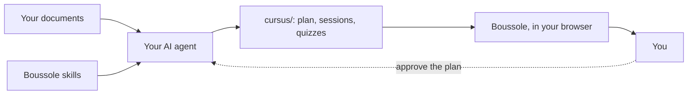

Welcome! This guide is itself a Boussole course: you go screen by screen and answer the
questions. It stays on the home page, to come back to whenever you like. It does not count in
your experience.

## Why "Boussole" {#why}

Boussole is French for compass. In front of a course, you sometimes feel lost: many documents,
and no clear path.

Boussole points the way. You know what to study, in what order, and where you are.

In practice:

- **Your documents become a course.** Short sessions, with questions corrected at once.
- **You know what to do next.** The home page offers the session to resume.
- **You pay for no platform.** The course is made from your documents, on your machine.
- **You spend fewer tokens.** Your agent does not reinvent the method each time: the
  :term[skills]{id=skill} tell it what to write and how. Boussole tells it exactly what is
  wrong. Then studying costs nothing more: Boussole corrects without AI.

::::mcq{#g1-a0}
When do you spend tokens with Boussole?

- [x] When your agent writes the course
- [ ] At each answer you give
  > No: Boussole corrects with the answer written in the session, without AI.
- [ ] Each time you open a session
  > No: opening a session only reads files on your machine.

:::hint
Who uses an AI: your agent, or Boussole?
:::

:::solution
Only when **your agent writes** the course. Once written, you study as much as you like without
spending tokens: Boussole corrects by itself.
:::
::::

## From documents to a course {#chain}

Here is the way from a document to you.

Boussole does not write the course. Your :term[AI agent]{id=agent} writes it, following the
skills. The course goes into the :term[cursus folder]{id=cursus}, and Boussole shows it.

::::mcq{#g1-a1}
Who writes the sessions and quizzes of your course?

- [ ] Boussole, with a built-in AI
  > No: Boussole never calls an AI. It shows, checks and keeps your progress.
- [x] Your AI agent, following Boussole's skills
- [ ] You, by hand
  > You may touch up the files, but the agent writes the course.

:::hint
Look at the diagram: which box writes into `cursus/`?
:::

:::solution
Your **AI agent** (Claude Code, Codex, Gemini CLI…) writes the course, following the skills.
Boussole calls no AI: it shows the course, checks it is well written and keeps your progress,
on your machine.
:::
::::

## Who does what {#roles}

| Who | Does |
|---|---|
| **You** | Put your documents in a folder, say how you learn, **approve the plan**, study. |
| **Your agent** | Reads the documents, proposes the :term[plan]{id=plan}, writes the sessions, checks them. |
| **Boussole** | Installs the skills, checks the format, shows the course, corrects your answers, keeps your progress. |

Everything stays on your machine: no account, no cloud. Your documents are never changed.

::::mcq{#g1-a2}
What does Boussole do when you answer a quiz?

- [ ] It sends your answer to an AI that judges it
  > No: the right answer is written in the session file; Boussole compares, without any AI.
- [x] It compares your answer with the one written in the session, and keeps your progress
- [ ] Nothing, it only shows the text
  > It does correct: green when right, red otherwise, with the explanation.

:::hint
Read the "Boussole" line of the table again.
:::

:::solution
Boussole **corrects**: the right answer and its explanation are in the session file, written by
the agent; Boussole compares your answer, shows the correction and keeps your progress.
:::
::::

:::::checkpoint
::::mcq{#g1-c1}
Who approves the plan of the course before the sessions are written?

- [x] You
- [ ] The agent, on its own
  > The agent proposes; it must never approve in your place.
- [ ] Boussole
  > Boussole checks the format, it does not decide the content.

:::hint
On the diagram, a dotted arrow goes back to the agent.
:::

:::solution
**You.** The agent proposes the plan, shows it to you and waits for your approval before writing
a single session.
:::
::::
:::::
