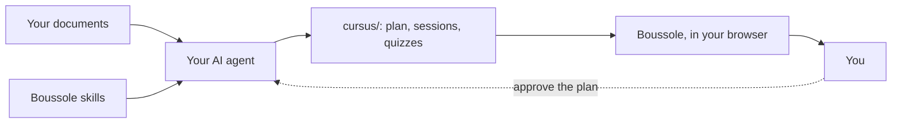

**Welcome to Boussole, because you look a little lost.** Ha. Anyway…

In this module, you will see:

- what Boussole does, and in what spirit;
- who does what, between you, your AI agent and Boussole;
- how you move through a session.

## Why "Boussole" {#why}

Boussole is French for compass. A folder of course documents is a map without a legend:
everything is there, but where do you start?

Boussole turns it into a path:

- **short sessions**, one notion at a time;
- **questions at every step**, corrected on the spot, with the why;
- **a heading**: you always know which session comes next.

:::tip
The spirit of Boussole: you learn by **answering**, not by rereading. Each session has you try
before it moves on.
:::

::::mcq{#g1-a0}
In a Boussole session, what do you do most?

- [ ] Read a long chapter from end to end
  > A session is cut into short screens: an explanation, then a question.
- [x] Answer questions, with the correction right after
- [ ] Watch a video, then move on
  > Videos come with the text; what matters are the questions.

:::hint
Read the tip again: how do you learn, with Boussole?
:::

:::solution
**You answer.** Each notion is followed by a question, corrected at once with its explanation:
trying is how you remember.
:::
::::

## From documents to a course {#chain}

Here is the way from a document to your screen.

1. Your :term[AI agent]{id=agent} reads your documents.
2. It writes the course following the :term[skills]{id=skill} of Boussole: sheets that tell it
   what a good session is.
3. The course lands in the :term[cursus folder]{id=cursus}, and Boussole presents it to you.

::::mcq{#g1-a1}
Who writes the sessions and quizzes of your course?

- [ ] Boussole, with a built-in AI
  > Boussole presents and corrects the course; your agent writes it.
- [x] Your AI agent, following Boussole's skills
- [ ] You, by hand
  > You may touch up the files, but the agent writes the course.

:::hint
Look at the diagram: which box writes into `cursus/`?
:::

:::solution
Your **AI agent** (Claude Code, Codex, Gemini CLI…) writes the course, following the skills.
Boussole checks it is well written, presents it to you and follows your progress.
:::
::::

## Who does what {#roles}

| Who | Does |
|---|---|
| **You** | Put your documents in a folder, say how you learn, **approve the plan**, study. |
| **Your agent** | Reads the documents, proposes the :term[plan]{id=plan}, writes the sessions, checks them. |
| **Boussole** | Installs the skills, checks the format, shows the course, corrects your answers, keeps your progress. |

Everything happens on your machine, next to your documents.

::::mcq{#g1-a2}
What does Boussole do when you answer a quiz?

- [ ] It sends your answer to an AI that judges it
  > The right answer and its explanation are already in the session: Boussole simply compares.
- [x] It compares your answer with the one written in the session, and keeps your progress
- [ ] Nothing, it only shows the text
  > It does correct: green when right, red otherwise, with the explanation.

:::hint
Read the "Boussole" line of the table again.
:::

:::solution
Boussole **corrects**: the right answer and its explanation are in the session file, written by
the agent; Boussole compares your answer, shows the correction and keeps your progress.
:::
::::

:::::checkpoint
::::mcq{#g1-c1}
Who approves the plan of the course before the sessions are written?

- [x] You
- [ ] The agent, on its own
  > The agent proposes; it must never approve in your place.
- [ ] Boussole
  > Boussole checks the format, it does not decide the content.

:::hint
On the diagram, a dotted arrow goes back to the agent.
:::

:::solution
**You.** The agent proposes the plan, shows it to you and waits for your approval before writing
a single session.
:::
::::
:::::
