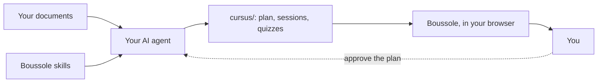

Welcome! This short guide is itself a Boussole subject: you go through it screen by screen, you
answer the questions, and the map on the left shows where you are. It stays apart on the home
page, to come back to when you forget, and does not count in your experience.

## From documents to a course {#chain}

Boussole turns **your own documents** (lecture notes, slides, problem sheets, past exams) into a
real course: short sessions, quizzes during the lesson, corrected exercises, videos and your
PDFs beside the text.

Boussole does not write the course: your :term[AI agent]{id=agent} does, guided by the
:term[skills]{id=skill} Boussole installs next to your documents. The result goes into the
:term[course folder]{id=cursus}, which Boussole shows.

::::mcq{#g1-a1}
Who writes the sessions and quizzes of your course?

- [ ] Boussole, with a built-in AI
  > No: Boussole never calls an AI. It shows, checks and keeps your progress.
- [x] Your AI agent, following Boussole's skills
- [ ] You, by hand
  > You may touch up the files, but the agent writes the course.

:::hint
Look at the diagram: which box writes into `cursus/`?
:::

:::solution
Your **AI agent** (Claude Code, Codex, Gemini CLI…) writes the course, following the skills.
Boussole calls no AI: it shows the course, checks it is well written and keeps your progress,
on your machine.
:::
::::

## Who does what {#roles}

| Who | Does |
|---|---|
| **You** | Put your documents in a folder, say how you learn, **approve the plan**, study. |
| **Your agent** | Reads the documents, proposes the :term[plan]{id=plan}, writes the sessions, checks them. |
| **Boussole** | Installs the skills, checks the format, shows the course, corrects your answers, keeps your progress. |

Everything stays on your machine: no account, no cloud. Your documents are never changed.

::::mcq{#g1-a2}
What does Boussole do when you answer a quiz?

- [ ] It sends your answer to an AI that judges it
  > No: the right answer is written in the session file; Boussole compares, without any AI.
- [x] It compares your answer with the one written in the session, and keeps your progress
- [ ] Nothing, it only shows the text
  > It does correct: green when right, red otherwise, with the explanation.

:::hint
Read the "Boussole" line of the table again.
:::

:::solution
Boussole **corrects**: the right answer and its explanation are in the session file, written by
the agent; Boussole compares your answer, shows the correction and keeps your progress.
:::
::::

:::::checkpoint
::::mcq{#g1-c1}
Who approves the plan of the course before the sessions are written?

- [x] You
- [ ] The agent, on its own
  > The agent proposes; it must never approve in your place.
- [ ] Boussole
  > Boussole checks the format, it does not decide the content.

:::hint
On the diagram, a dotted arrow goes back to the agent.
:::

:::solution
**You.** The agent proposes the plan, shows it to you and waits for your approval before writing
a single session.
:::
::::
:::::
