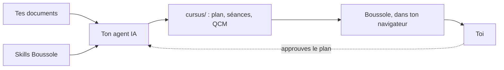

Bienvenue ! Ce petit guide est lui-même une matière Boussole : tu y avances écran par écran, tu
réponds aux questions, et la carte à gauche montre où tu en es. Il s'efface dès que tu ajoutes
ta première matière.

## Du document au cours {#chaine}

Boussole transforme **tes propres documents** (polycopiés, transparents, feuilles de TD,
annales) en un vrai cours : des séances courtes, des QCM pendant la leçon, des exercices
corrigés, des vidéos et tes PDF à côté du texte.

Ce n'est pas Boussole qui écrit le cours : c'est ton :term[agent IA]{id=agent}, guidé par les
:term[skills]{id=skill} que Boussole installe à côté de tes documents. Le résultat va dans le
dossier :term[cursus]{id=cursus}, que Boussole affiche.

::::mcq{#g1-a1}
Qui écrit les séances et les QCM de ton cours ?

- [ ] Boussole, avec une IA intégrée
  > Non : Boussole n'appelle jamais d'IA. Il affiche, vérifie et suit ta progression.
- [x] Ton agent IA, en suivant les skills de Boussole
- [ ] Toi, à la main
  > Tu peux retoucher les fichiers, mais c'est l'agent qui écrit le cours.

:::hint
Regarde le schéma : quelle case écrit dans `cursus/` ?
:::

:::solution
Ton **agent IA** (Claude Code, Codex, Gemini CLI…) écrit le cours en suivant les skills.
Boussole, lui, n'appelle aucune IA : il affiche le cours, vérifie qu'il est bien écrit et garde
ta progression, sur ta machine.
:::
::::

## Qui fait quoi {#roles}

| Qui | Fait |
|---|---|
| **Toi** | Ranges tes documents, dis comment tu apprends, **approuves le plan**, étudies. |
| **Ton agent** | Lit les documents, propose le :term[plan]{id=plan}, écrit les séances, les vérifie. |
| **Boussole** | Installe les skills, vérifie le format, affiche le cours, corrige tes réponses, garde ta progression. |

Tout reste sur ta machine : pas de compte, pas de cloud. Tes documents ne sont jamais modifiés.

::::mcq{#g1-a2}
Que fait Boussole quand tu réponds à un QCM ?

- [ ] Il envoie ta réponse à une IA qui la juge
  > Non : la bonne réponse est écrite dans le fichier de la séance ; Boussole la compare, sans IA.
- [x] Il compare ta réponse à celle écrite dans la séance, et garde ta progression
- [ ] Rien, il affiche seulement le texte
  > Il corrige bel et bien : vert si c'est juste, rouge sinon, avec l'explication.

:::hint
Relis la ligne « Boussole » du tableau.
:::

:::solution
Boussole **corrige** : la bonne réponse et son explication sont dans le fichier de la séance,
écrites par l'agent ; Boussole compare ta réponse, affiche la correction et garde ta progression.
:::
::::

:::::checkpoint
::::mcq{#g1-c1}
Qui approuve le plan du cours avant que les séances soient écrites ?

- [x] Toi
- [ ] L'agent, tout seul
  > L'agent propose ; il ne doit jamais approuver à ta place.
- [ ] Boussole
  > Boussole vérifie le format, il ne décide pas du contenu.

:::hint
Sur le schéma, une flèche en pointillés revient vers l'agent.
:::

:::solution
**Toi.** L'agent propose le plan, te le montre et attend ton accord avant d'écrire la moindre
séance.
:::
::::
:::::
