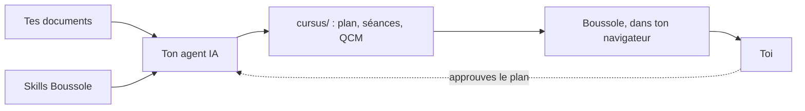

Bienvenue ! Ce guide est lui-même un cours Boussole : tu avances écran par écran et tu réponds
aux questions. Il reste sur l'accueil, pour y revenir quand tu veux. Il ne compte pas dans ton
expérience.

## Pourquoi « Boussole » {#pourquoi}

Devant un cours, on est parfois désorienté : beaucoup de documents, et pas de chemin clair.

Boussole t'indique la direction. Tu sais quoi étudier, dans quel ordre, et où tu en es.

Concrètement :

- **Tes documents deviennent un cours.** Des séances courtes, avec des questions corrigées tout
  de suite.
- **Tu sais quoi faire ensuite.** L'accueil te propose la séance à reprendre.
- **Tu ne paies pas de plateforme.** Le cours est fait à partir de tes documents, sur ta
  machine.
- **Tu dépenses moins de tokens.** Ton agent ne réinvente pas la méthode à chaque fois : les
  :term[skills]{id=skill} lui disent quoi écrire et comment. Boussole lui dit précisément ce qui
  ne va pas. Ensuite, réviser ne coûte plus rien : Boussole corrige sans IA.

::::mcq{#g1-a0}
Quand dépenses-tu des tokens avec Boussole ?

- [x] Quand ton agent écrit le cours
- [ ] À chaque réponse que tu donnes
  > Non : Boussole corrige avec la réponse écrite dans la séance, sans IA.
- [ ] À chaque fois que tu ouvres une séance
  > Non : ouvrir une séance lit seulement des fichiers sur ta machine.

:::hint
Qui utilise une IA : ton agent, ou Boussole ?
:::

:::solution
Seulement quand **ton agent écrit** le cours. Une fois écrit, tu étudies autant que tu veux sans
dépenser de tokens : Boussole corrige lui-même.
:::
::::

## Du document au cours {#chaine}

Voici le chemin d'un document jusqu'à toi.

Boussole n'écrit pas le cours. C'est ton :term[agent IA]{id=agent} qui l'écrit, en suivant les
skills. Le cours va dans le dossier :term[cursus]{id=cursus}, et Boussole l'affiche.

::::mcq{#g1-a1}
Qui écrit les séances et les QCM de ton cours ?

- [ ] Boussole, avec une IA intégrée
  > Non : Boussole n'appelle jamais d'IA. Il affiche, vérifie et suit ta progression.
- [x] Ton agent IA, en suivant les skills de Boussole
- [ ] Toi, à la main
  > Tu peux retoucher les fichiers, mais c'est l'agent qui écrit le cours.

:::hint
Regarde le schéma : quelle case écrit dans `cursus/` ?
:::

:::solution
Ton **agent IA** (Claude Code, Codex, Gemini CLI…) écrit le cours en suivant les skills.
Boussole, lui, n'appelle aucune IA : il affiche le cours, vérifie qu'il est bien écrit et garde
ta progression, sur ta machine.
:::
::::

## Qui fait quoi {#roles}

| Qui | Fait |
|---|---|
| **Toi** | Ranges tes documents, dis comment tu apprends, **approuves le plan**, étudies. |
| **Ton agent** | Lit les documents, propose le :term[plan]{id=plan}, écrit les séances, les vérifie. |
| **Boussole** | Installe les skills, vérifie le format, affiche le cours, corrige tes réponses, garde ta progression. |

Tout reste sur ta machine. Pas de compte. Tes documents ne sont jamais modifiés.

::::mcq{#g1-a2}
Que fait Boussole quand tu réponds à un QCM ?

- [ ] Il envoie ta réponse à une IA qui la juge
  > Non : la bonne réponse est écrite dans le fichier de la séance ; Boussole la compare, sans IA.
- [x] Il compare ta réponse à celle écrite dans la séance, et garde ta progression
- [ ] Rien, il affiche seulement le texte
  > Il corrige bel et bien : vert si c'est juste, rouge sinon, avec l'explication.

:::hint
Relis la ligne « Boussole » du tableau.
:::

:::solution
Boussole **corrige** : la bonne réponse et son explication sont dans le fichier de la séance,
écrites par l'agent ; Boussole compare ta réponse, affiche la correction et garde ta progression.
:::
::::

:::::checkpoint
::::mcq{#g1-c1}
Qui approuve le plan du cours avant que les séances soient écrites ?

- [x] Toi
- [ ] L'agent, tout seul
  > L'agent propose ; il ne doit jamais approuver à ta place.
- [ ] Boussole
  > Boussole vérifie le format, il ne décide pas du contenu.

:::hint
Sur le schéma, une flèche en pointillés revient vers l'agent.
:::

:::solution
**Toi.** L'agent propose le plan, te le montre et attend ton accord avant d'écrire la moindre
séance.
:::
::::
:::::
