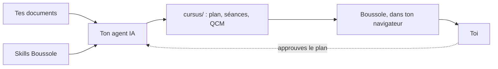

**Bienvenue dans Boussole, parce que tu as l'air désorienté.** Haha. Bref…

Dans ce module, tu vas voir :

- ce que fait Boussole, et dans quel esprit ;
- qui fait quoi, entre toi, ton agent IA et Boussole ;
- comment on avance dans une séance.

## Pourquoi « Boussole » {#pourquoi}

Un dossier de cours, c'est une carte sans légende : tout y est, mais par où commencer ?

Boussole en fait un chemin :

- **des séances courtes**, une notion à la fois ;
- **des questions à chaque étape**, corrigées sur le moment, avec le pourquoi ;
- **un cap** : tu sais toujours quelle est la séance suivante.

:::tip
L'esprit de Boussole : on apprend en **répondant**, pas en relisant. Chaque séance te fait
essayer avant de passer à la suite.
:::

::::mcq{#g1-a0}
Dans une séance Boussole, que fais-tu le plus souvent ?

- [ ] Lire un long chapitre d'un bout à l'autre
  > Une séance est découpée en écrans courts : une explication, puis une question.
- [x] Répondre à des questions, avec la correction juste après
- [ ] Regarder une vidéo, puis passer à la suite
  > Les vidéos accompagnent le texte ; l'essentiel, ce sont les questions.

:::hint
Relis l'astuce : comment apprend-on, avec Boussole ?
:::

:::solution
**Tu réponds.** Chaque notion est suivie d'une question, corrigée tout de suite avec son
explication : c'est en essayant qu'on retient.
:::
::::

## Du document au cours {#chaine}

Voici le chemin d'un document jusqu'à ton écran.

1. Ton :term[agent IA]{id=agent} lit tes documents.
2. Il écrit le cours en suivant les :term[skills]{id=skill} de Boussole : des fiches qui lui
   disent ce qu'est une bonne séance.
3. Le cours arrive dans le dossier :term[cursus]{id=cursus}, et Boussole te le présente.

::::mcq{#g1-a1}
Qui écrit les séances et les QCM de ton cours ?

- [ ] Boussole, avec une IA intégrée
  > Boussole présente et corrige le cours ; c'est ton agent qui l'écrit.
- [x] Ton agent IA, en suivant les skills de Boussole
- [ ] Toi, à la main
  > Tu peux retoucher les fichiers, mais c'est l'agent qui écrit le cours.

:::hint
Regarde le schéma : quelle case écrit dans `cursus/` ?
:::

:::solution
Ton **agent IA** (Claude Code, Codex, Gemini CLI…) écrit le cours en suivant les skills.
Boussole vérifie qu'il est bien écrit, te le présente et suit ta progression.
:::
::::

## Qui fait quoi {#roles}

| Qui | Fait |
|---|---|
| **Toi** | Ranges tes documents, dis comment tu apprends, **approuves le plan**, étudies. |
| **Ton agent** | Lit les documents, propose le :term[plan]{id=plan}, écrit les séances, les vérifie. |
| **Boussole** | Installe les skills, vérifie le format, affiche le cours, corrige tes réponses, garde ta progression. |

Tout se passe sur ta machine, à côté de tes documents.

::::mcq{#g1-a2}
Que fait Boussole quand tu réponds à un QCM ?

- [ ] Il envoie ta réponse à une IA qui la juge
  > La bonne réponse et son explication sont déjà dans la séance : Boussole compare, tout simplement.
- [x] Il compare ta réponse à celle écrite dans la séance, et garde ta progression
- [ ] Rien, il affiche seulement le texte
  > Il corrige bel et bien : vert si c'est juste, rouge sinon, avec l'explication.

:::hint
Relis la ligne « Boussole » du tableau.
:::

:::solution
Boussole **corrige** : la bonne réponse et son explication sont dans le fichier de la séance,
écrites par l'agent ; Boussole compare ta réponse, affiche la correction et garde ta progression.
:::
::::

:::::checkpoint
::::mcq{#g1-c1}
Qui approuve le plan du cours avant que les séances soient écrites ?

- [x] Toi
- [ ] L'agent, tout seul
  > L'agent propose ; il ne doit jamais approuver à ta place.
- [ ] Boussole
  > Boussole vérifie le format, il ne décide pas du contenu.

:::hint
Sur le schéma, une flèche en pointillés revient vers l'agent.
:::

:::solution
**Toi.** L'agent propose le plan, te le montre et attend ton accord avant d'écrire la moindre
séance.
:::
::::
:::::
