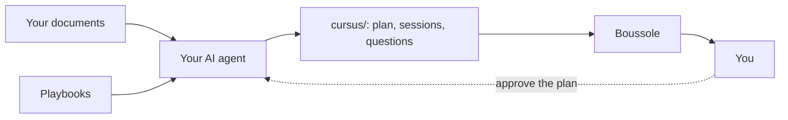

**Too many documents, no path?** That is what Boussole is for.

In fifteen minutes, this module shows you:

- what Boussole makes of your documents;
- who does what: you, your AI agent and Boussole;
- how you move through a session.

## Why "Boussole" {#why}

Boussole is French for compass. A compass does not walk for you: it shows you north. Same here.

| The problem | What Boussole does |
|---|---|
| "I have a pile of documents, not a path." | It turns them into a :term[track]{id=track} of short sessions. |
| "A whole chapter in one go is discouraging." | Each session moves in :term[steps]{id=step}: an explanation, then a question. |
| "I don't know if I understood." | Every answer gets an **explained answer**, right away. |
| "Where did I stop?" | The home page offers to **continue** where you left off. |

:::tip
The idea of Boussole: you learn by **answering**, not by rereading.
:::

::::mcq{#g1-a0}
In a Boussole session, what do you do most?

- [ ] Read a long chapter from end to end
  > A session is cut into short steps: an explanation, then a question.
- [x] Answer questions, with the correction right after
- [ ] Watch a video, then move on
  > Videos come with the text; what matters are the questions.

:::hint
Read the tip again: how do you learn, with Boussole?
:::

:::solution
**You answer.** Each notion is followed by a question, corrected at once with its explanation:
trying is how you remember.
:::
::::

## From documents to a track {#chain}

1. Your :term[AI agent]{id=agent} reads your documents.
2. It writes the track following the :term[playbooks]{id=skill} of Boussole.
3. The track lands in the :term[cursus folder]{id=cursus}, and Boussole presents it to you.

::::mcq{#g1-a1}
Who writes the sessions and questions of your track?

- [ ] Boussole, with a built-in AI
  > Boussole presents and corrects the track; your agent writes it.
- [x] Your AI agent, following the playbooks of Boussole
- [ ] You, by hand
  > You can touch up the files, but the agent writes the track.

:::hint
Look at the diagram: which box writes into `cursus/`?
:::

:::solution
Your **AI agent** (Claude Code, Codex, Gemini CLI…) writes the track, following the playbooks.
Boussole checks it is well written, presents it to you and follows your progress.
:::
::::

## Who does what {#roles}

| Who | Role |
|---|---|
| **You** | You gather your documents, say how you learn, **approve the plan** and study. |
| **Your agent** | It reads the documents, proposes the :term[plan]{id=plan}, writes the sessions and checks them. |
| **Boussole** | It guides your agent, checks the track, presents it to you, corrects your answers and follows your progress. |

Everything happens on your machine, next to your documents.

::::mcq{#g1-a2}
What does Boussole do when you answer a question?

- [ ] It sends your answer to an AI that judges it
  > The right answer and its explanation are already in the session: Boussole simply compares.
- [x] It compares your answer with the one written in the session, and follows your progress
- [ ] Nothing, it only shows the text
  > It does correct: green if right, red if not, with the explanation.

:::hint
Read the "Boussole" row of the table again.
:::

:::solution
Boussole **corrects**: the right answer and its explanation are in the session, written by the
agent. Boussole compares your answer, shows the correction and follows your progress.
:::
::::

:::::checkpoint
::::mcq{#g1-c1}
Who approves the plan of the track before the sessions are written?

- [x] You
- [ ] The agent, on its own
  > The agent proposes; you decide.
- [ ] Boussole
  > Boussole checks the form, not the content.

:::hint
On the diagram, a dashed arrow goes back to the agent.
:::

:::solution
**You.** The agent proposes the plan, shows it to you and waits for your approval before writing
a single session.
:::
::::
:::::
