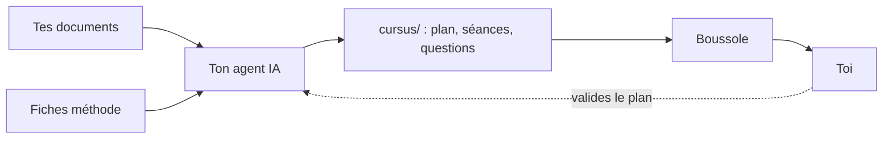

**Trop de documents, pas de chemin ?** Boussole est fait pour ça.

En quinze minutes, ce module te montre :

- ce que Boussole fait de tes documents ;
- qui fait quoi : toi, ton agent IA et Boussole ;
- comment on avance dans une séance.

## Pourquoi « Boussole » {#why}

Une boussole ne marche pas à ta place : elle t'indique le nord. Ici, c'est pareil.

| Le problème | Ce que fait Boussole |
|---|---|
| « J'ai un tas de documents, pas un chemin. » | Il en fait un :term[parcours]{id=parcours} de séances courtes. |
| « Un chapitre d'un bloc, ça décourage. » | Chaque séance avance par :term[étapes]{id=etape} : une explication, puis une question. |
| « Je ne sais pas si j'ai compris. » | Chaque réponse reçoit une **correction expliquée**, aussitôt. |
| « Où est-ce que je m'étais arrêté ? » | L'accueil te propose de **reprendre** là où tu en étais. |

:::tip
L'idée de Boussole : on apprend en **répondant**, pas en relisant.
:::

::::mcq{#g1-a0}
Dans une séance Boussole, que fais-tu le plus souvent ?

- [ ] Lire un long chapitre d'un bout à l'autre
  > Une séance est découpée en étapes courtes : une explication, puis une question.
- [x] Répondre à des questions, avec la correction juste après
- [ ] Regarder une vidéo, puis passer à la suite
  > Les vidéos accompagnent le texte ; l'essentiel, ce sont les questions.

:::hint
Relis l'astuce : comment apprend-on, avec Boussole ?
:::

:::solution
**Tu réponds.** Chaque notion est suivie d'une question, corrigée tout de suite avec son
explication : c'est en essayant qu'on retient.
:::
::::

## Du document au parcours {#chain}

1. Ton :term[agent IA]{id=agent} lit tes documents.
2. Il écrit le parcours en suivant les :term[fiches méthode]{id=skill} de Boussole.
3. Le parcours arrive dans le dossier :term[cursus]{id=cursus}, et Boussole te le présente.

::::mcq{#g1-a1}
Qui écrit les séances et les questions de ton parcours ?

- [ ] Boussole, avec une IA intégrée
  > Boussole présente et corrige le parcours ; c'est ton agent qui l'écrit.
- [x] Ton agent IA, en suivant les fiches méthode de Boussole
- [ ] Toi, à la main
  > Tu peux retoucher les fichiers, mais c'est l'agent qui écrit le parcours.

:::hint
Regarde le schéma : quelle case écrit dans `cursus/` ?
:::

:::solution
Ton **agent IA** (Claude Code, Codex, Gemini CLI…) écrit le parcours en suivant les fiches
méthode. Boussole vérifie qu'il est bien écrit, te le présente et suit ta progression.
:::
::::

## Qui fait quoi {#roles}

| Qui | Rôle |
|---|---|
| **Toi** | Tu ranges tes documents, dis comment tu apprends, **valides le plan** et étudies. |
| **Ton agent** | Il lit les documents, propose le :term[plan]{id=plan}, écrit les séances et les vérifie. |
| **Boussole** | Il guide ton agent, vérifie le parcours, te le présente, corrige tes réponses et suit ta progression. |

Tout se passe sur ta machine, à côté de tes documents.

::::mcq{#g1-a2}
Que fait Boussole quand tu réponds à une question ?

- [ ] Il envoie ta réponse à une IA qui la juge
  > La bonne réponse et son explication sont déjà dans la séance : Boussole compare, tout simplement.
- [x] Il compare ta réponse à celle écrite dans la séance, et suit ta progression
- [ ] Rien, il affiche seulement le texte
  > Il corrige bel et bien : vert si c'est juste, rouge sinon, avec l'explication.

:::hint
Relis la ligne « Boussole » du tableau.
:::

:::solution
Boussole **corrige** : la bonne réponse et son explication sont dans la séance, écrites par
l'agent. Boussole compare ta réponse, affiche la correction et suit ta progression.
:::
::::

:::::checkpoint
::::mcq{#g1-c1}
Qui valide le plan du parcours avant que les séances soient écrites ?

- [x] Toi
- [ ] L'agent, tout seul
  > L'agent propose ; c'est toi qui décides.
- [ ] Boussole
  > Boussole vérifie la forme, pas le contenu.

:::hint
Sur le schéma, une flèche en pointillés revient vers l'agent.
:::

:::solution
**Toi.** L'agent propose le plan, te le montre et attend ton accord avant d'écrire la moindre
séance.
:::
::::
:::::
